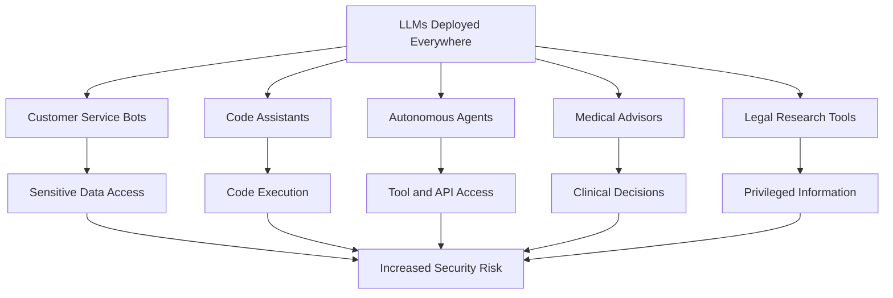
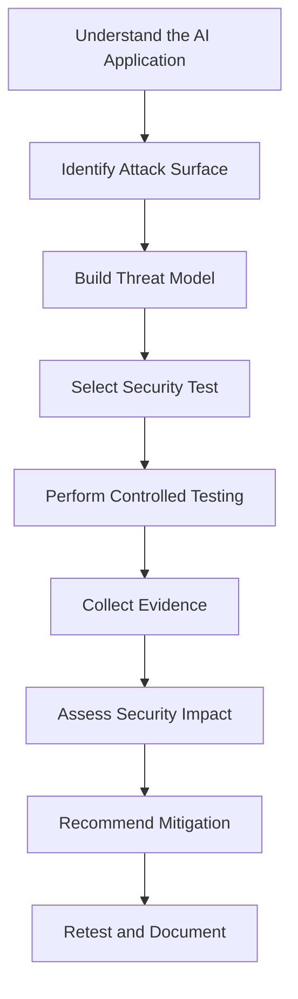

# Getting Started with LLM Penetration Testing

## Welcome to AI Security

Welcome to the **LLM Penetration Testing & AI Security Knowledge Base**.

I'm Ramcharan, and this repository is my hands-on learning journey into Artificial Intelligence Security, LLM penetration testing, and real-world AI threat analysis.

AI is changing how companies build applications, automate workflows, process information, and make decisions. But as AI becomes more powerful, it also introduces new security challenges.

This knowledge base focuses on understanding those risks, learning how attackers exploit AI applications, and discovering how security professionals identify, test, and mitigate them.

**The objective is simple: Learn how AI systems work, understand how they can be attacked, and build the skills to secure them.**

---

## 1. What Is LLM Security?

Large Language Model (LLM) Security is a branch of cybersecurity focused on identifying, testing, and mitigating vulnerabilities in applications powered by large language models.

Unlike traditional applications, LLM-based systems introduce additional attack surfaces.

Here are some important characteristics:

- **Probabilistic Behaviour:** LLMs generate responses based on learned patterns rather than following completely deterministic instructions.
- **Natural Language as an Attack Surface:** Attackers can manipulate model behaviour through carefully crafted prompts.
- **Emergent Capabilities:** Models may demonstrate unexpected behaviours that developers did not explicitly anticipate.
- **Context Window as State:** Conversation history, retrieved documents, and injected instructions can influence model responses.
- **Complex Supply Chain:** Models, datasets, embeddings, APIs, plugins, and third-party services introduce additional security risks.

In simple terms, LLM security is about protecting AI applications from manipulation, unauthorized access, information leakage, and unsafe actions.

---

## 2. Why Does LLM Security Matter?

AI is no longer limited to answering simple questions. Companies are integrating LLMs into systems that interact with sensitive business operations.

### Where Are LLMs Being Used?

| Application | Security Concern |
|---|---|
| Customer Service Bots | Access to customer information and PII |
| Code Assistants | Unsafe code generation and execution |
| Autonomous AI Agents | Unauthorized tool and API access |
| Medical AI Assistants | Exposure of sensitive medical records |
| Legal Research Tools | Disclosure of privileged information |
| Financial AI Applications | Unauthorized transactions and financial data exposure |

### Understanding the Attack Surface



Modern AI applications may:

- Process personally identifiable information (PII).
- Generate and execute code.
- Connect to databases and external APIs.
- Retrieve information from private documents.
- Perform actions through autonomous agents.
- Support financial and business operations.

Every additional capability creates another area that security teams must evaluate.

---

## 3. Core Concepts Every LLM Security Researcher Must Understand

### 3.1 The Prompt as an Attack Vector

In traditional application security, attackers often target APIs, network services, authentication mechanisms, and file inputs.

In LLM applications, natural language itself becomes an important attack surface.

A carefully crafted prompt may attempt to:

- Override application instructions.
- Bypass safety controls.
- Extract confidential system instructions.
- Manipulate retrieved information.
- Trigger unauthorized tool execution.
- Influence the model to disclose sensitive data.

**Example:** An attacker submits a prompt designed to convince a customer support chatbot to reveal information that should only be available to authorized employees.

This is one reason prompt injection is a major concern in AI security.

### 3.2 Understanding the Trust Hierarchy

LLM applications receive information from different sources. Not every source should have the same level of trust.

A simplified trust model looks like this:

```text
System Instructions       → Application-defined instructions
Developer Instructions    → Application behaviour and rules
User Messages             → Untrusted user input
External Documents        → Untrusted retrieved content
Tool Outputs              → Data requiring validation
```

The security challenge is ensuring that untrusted content cannot override trusted instructions or trigger unauthorized actions.

**Important concept: Indirect Prompt Injection**

An attacker may place malicious instructions inside a webpage, PDF, email, or document that an AI system later retrieves.

The user does not necessarily need to submit the malicious prompt directly. The AI application may encounter it while processing external content.

### 3.3 Alignment vs. Security

AI alignment and AI security are related, but they solve different problems.

- **Alignment:** Attempts to make AI systems behave according to intended values, policies, and instructions.
- **Security:** Ensures that systems enforce access controls, validate inputs, restrict actions, and protect sensitive resources.

Techniques such as RLHF (Reinforcement Learning from Human Feedback) and Constitutional AI can improve model behaviour.

However, they should not replace application-level security controls.

A model refusing a dangerous request is useful. An application preventing unauthorized access even when the model produces an unsafe response is essential.

---

## 4. OWASP Top 10 for LLM Applications

The OWASP GenAI Security Project provides guidance on the major security risks affecting LLM-powered applications.

Understanding these vulnerabilities is an important starting point for AI penetration testing.

### OWASP Top 10 — 2025 Edition

| ID | Vulnerability | What It Means |
|---|---|---|
| LLM01 | Prompt Injection | Manipulating model behaviour through crafted instructions. |
| LLM02 | Sensitive Information Disclosure | Exposing confidential information, PII, or business data. |
| LLM03 | Supply Chain | Risks involving third-party models, datasets, platforms, and dependencies. |
| LLM04 | Data and Model Poisoning | Manipulating training, fine-tuning, or embedding data. |
| LLM05 | Improper Output Handling | Using model outputs without proper validation or sanitization. |
| LLM06 | Excessive Agency | Giving AI agents excessive permissions or autonomy. |
| LLM07 | System Prompt Leakage | Exposing confidential information contained in system instructions. |
| LLM08 | Vector and Embedding Weaknesses | Exploiting weaknesses in vector databases and retrieval systems. |
| LLM09 | Misinformation | Generating incorrect information that users or systems may trust. |
| LLM10 | Unbounded Consumption | Excessive resource usage, potentially causing service disruption or unexpected costs. |

**Why should penetration testers study this?**

Each vulnerability represents a category of security testing. Our objective is to understand how these issues occur, reproduce them safely in controlled environments, and recommend appropriate mitigations.

> Version note: The original ten-item list in older OWASP material was the 2023 v1.1 taxonomy. This repository uses the updated 2025 taxonomy above. OWASP has also published a 2026 edition, so always identify the version when documenting findings.

Reference: [OWASP GenAI Security Project – LLM Top 10](https://genai.owasp.org/llm-top-10/)

---

## 5. Advanced AI Security Concepts

Once the fundamentals are clear, we need to understand how modern AI applications are built and where their security weaknesses can appear.

These topics will be covered in dedicated sections throughout this repository.

### 5.1 Retrieval-Augmented Generation (RAG) Security

RAG allows an LLM to retrieve information from external knowledge sources before generating an answer.

Security areas to investigate:

- Unauthorized document retrieval.
- Cross-user data exposure.
- Malicious document injection.
- Vector database access control.
- Embedding manipulation.
- Retrieval permission bypass.

### 5.2 Agentic AI Security

AI agents can interact with external tools and perform tasks with limited human intervention.

Examples include:

- Executing Python scripts.
- Querying databases.
- Calling APIs.
- Reading and writing files.
- Sending emails.
- Automating business workflows.

Testing objectives:

- Excessive permissions.
- Unauthorized tool invocation.
- Unsafe execution of generated code.
- Tool parameter manipulation.
- Missing human approval.
- Insecure agent-to-agent communication.

### 5.3 System Prompt Extraction

System prompts contain application instructions, behavioural rules, and sometimes accidentally embedded sensitive information.

Testing should identify whether confidential instructions or secrets are exposed through model responses.

Remember: A system prompt is not an access-control mechanism. API keys, credentials, and authorization secrets must never rely on prompt confidentiality.

### 5.4 LLM API Security

AI applications frequently communicate with models through APIs.

Areas to assess:

- Authentication and authorization.
- API key exposure.
- Broken access control.
- Rate limiting.
- Request validation.
- Sensitive response leakage.
- Insecure session management.
- Excessive API permissions.

### 5.5 Multimodal AI Security

Modern AI systems can process text, images, audio, and video.

This introduces additional testing areas:

- Image-based prompt injection.
- Hidden instructions in visual content.
- Audio transcription manipulation.
- Malicious document and media processing.
- Unsafe handling of multimodal inputs.

### 5.6 AI Supply Chain Security

AI systems depend on external models, datasets, libraries, plugins, and infrastructure.

Security assessments should consider:

- Untrusted model repositories.
- Malicious model files.
- Vulnerable Python dependencies.
- Compromised datasets.
- Model provenance and integrity.
- Insecure third-party integrations.

---

## 6. Your First Steps: Learning Roadmap

Don't jump directly into jailbreak payloads or advanced exploitation.

First understand the architecture, then learn the attack surface, and finally perform controlled security testing.

Follow this learning sequence:

**Step 1 — Understand LLM Fundamentals**

Read: `01-LLM-Fundamentals/LLM-Architecture.md`

Learn:
- What LLMs are.
- Transformer architecture.
- Tokens and tokenization.
- Context windows.
- Model inference.
- Embeddings.

**Step 2 — Learn AI Threat Modeling**

Read: `02-Threat-Modeling/AI-Threat-Model.md`

Learn:
- Threat identification.
- Assets and trust boundaries.
- Attack scenarios.
- Security requirements.
- Risk assessment.

**Step 3 — Understand the AI Attack Surface**

Read: `03-LLM-Attack-Surface/Attack-Surface-Map.md`

Identify:
- User input.
- System instructions.
- Model APIs.
- External data sources.
- Vector databases.
- Plugins and tools.
- Output handling.

**Step 4 — Learn Prompt Injection**

Read: `04-Prompt-Injection/Introduction.md`

Understand:
- Direct prompt injection.
- Indirect prompt injection.
- Instruction conflicts.
- Context manipulation.
- Security mitigations.

**Step 5 — Perform Your First Lab**

Lab: `33-Labs/Lab-01-Basic-Prompt-Injection.md`

Practice in a controlled environment and document:

1. Lab objective.
2. Application architecture.
3. Test scenario.
4. Input and expected behaviour.
5. Actual result.
6. Security impact.
7. Recommended mitigation.

**Learning recommendation:** Spend at least two hours understanding LLM architecture before beginning practical exploitation.

---

## 7. Tools Used in LLM Penetration Testing

A security researcher should understand both traditional application security tools and tools specifically designed for AI security testing.

### Essential Tools

| Tool | Purpose | Level |
|---|---|---|
| Python 3.10+ | Automation and security scripting | Beginner |
| Burp Suite | Intercepting and analysing application/API traffic | Intermediate |
| Garak | LLM vulnerability scanning and probing | Intermediate |
| Promptfoo | LLM security evaluations and red-team testing | Beginner |
| Docker | Building isolated lab environments | Beginner |
| Obsidian | Maintaining research notes and documentation | Beginner |

### Additional Tools Worth Learning

| Tool | Purpose |
|---|---|
| Microsoft PyRIT | Framework for AI red teaming and risk assessment |
| OWASP ZAP | Web application and API security testing |
| Semgrep | Static analysis and insecure code detection |
| MITRE ATLAS | Understanding adversarial threats against AI systems |
| Wireshark | Network traffic analysis |
| Git and GitHub | Version control and security research documentation |

### Setting Up the Basic Environment

**1. Create a Python virtual environment**

```bash
python3 -m venv llm-pentest
```

**2. Activate the environment on Linux/Kali**

```bash
source llm-pentest/bin/activate
```

**3. Install the initial Python packages**

```bash
pip install garak promptfoo openai anthropic langchain
```

**4. Install Docker on supported Linux systems**

```bash
curl -fsSL https://get.docker.com | sh
```

**Note:** Docker installation commands differ across Linux distributions and operating systems. Follow the official installation documentation for your environment.

---

## 8. How We Will Approach Practical Testing

Understanding a vulnerability is only the beginning. A penetration tester must be able to identify, reproduce, analyse, and report it.

For every practical exercise in this repository, we will follow a consistent methodology:



Every lab should contain:

- **Objective:** What are we trying to test?
- **Environment:** Which application, model, and tools are being used?
- **Methodology:** How is the test performed?
- **Evidence:** What did we observe?
- **Impact:** What could happen if the issue exists in production?
- **Mitigation:** How should developers fix it?
- **Retesting:** Does the security control work after remediation?

All practical exercises must be conducted against applications we own or have explicit permission to test.

---

## 9. Community and Learning Resources

Continuous learning is essential in AI security because attack techniques, models, and defensive technologies evolve rapidly.

Explore these sections as the repository grows:

- `40-Resources/Communities.md` — AI security communities, forums, and discussion groups.
- `35-Research-Papers/Reading-List.md` — Important research papers and technical publications.
- `38-Certifications/AI-Security-Certifications.md` — Relevant AI and cybersecurity certifications.
- `37-Interview-Preparation/AI-Security-Interview-Guide.md` — Technical interview preparation and career guidance.

Additional references:

- [OWASP GenAI Security Project](https://genai.owasp.org/)
- [MITRE ATLAS](https://atlas.mitre.org/)
- [NIST AI Risk Management Framework](https://www.nist.gov/itl/ai-risk-management-framework)
- [Garak Documentation](https://garak.ai/)
- [Promptfoo Documentation](https://www.promptfoo.dev/docs/)

---

## 10. What Comes Next?

This is the starting point of our LLM security journey.

We will gradually move from understanding AI architecture to identifying vulnerabilities, performing penetration tests, analysing attack scenarios, and implementing defensive security controls.

The focus will remain on practical learning rather than memorising definitions.

**Our learning path:**

1. LLM Fundamentals and Architecture.
2. AI Threat Modeling.
3. LLM Attack Surface Mapping.
4. Prompt Injection and Jailbreak Testing.
5. Sensitive Information Disclosure.
6. RAG and Vector Database Security.
7. AI Agent and Tool Security.
8. LLM API Penetration Testing.
9. AI Red Teaming and Automated Security Testing.
10. Real-World AI Security Assessments.

---

**Next Chapter:** [LLM Architecture](../01-LLM-Fundamentals/LLM-Architecture.md)

*Learn the architecture first. Understand the attack surface next. Test responsibly. Build secure AI systems.*

**— Ramcharan | AI Security & Cybersecurity Research**
